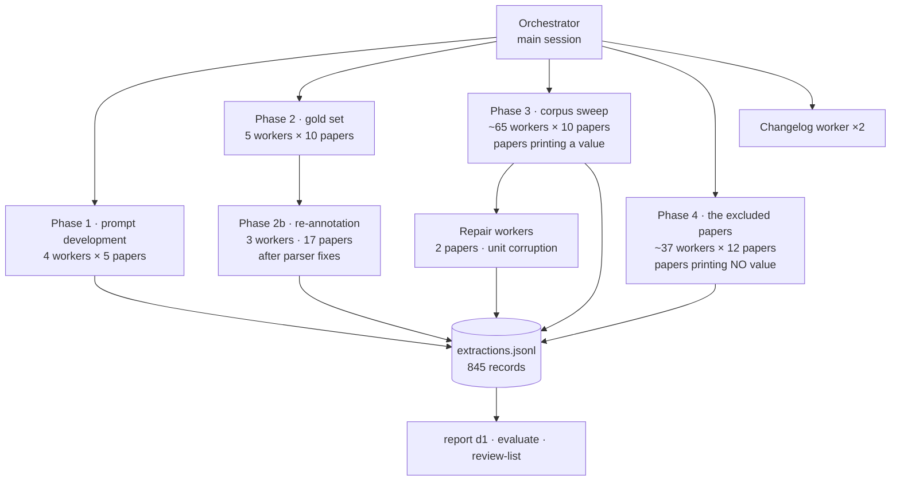

# How this corpus was built — the agent map, and what I would change

Written 2026-09-13, from the run artefacts rather than from memory. Every number here was
read back out of `data/interim/extractions.jsonl`, `out/tables/` or the test suite; where a
number could not be verified it is marked as such.

The purpose is twofold: to document the method well enough that someone could defend it in
a talk, and to record honestly where the orchestration was weaker than it looked.

---

## 1. What the pipeline is

Five stages, only one of which involves a language model:

| Stage | Module | Command | Deterministic? |
|---|---|---|---|
| Search Europe PMC | `corpus/epmc.py` | `corpus search` | yes |
| Fetch full text (JATS XML) | `corpus/epmc.py` | `corpus fetch` | yes |
| Parse to sections, tables, captions | `corpus/jats.py` | `corpus parse` | yes |
| **Scan for printed values** | `extract/zeta.py` | (internal) | **yes — regex** |
| **Read the paper, write rows** | worker agent | `extract show` → `extract ingest` | **no — judgement** |
| Verify rows against the article | `extract/zeta.py` | (on ingest) | yes |
| Aggregate, report | `report/d1.py` | `report d1` | yes |

The division matters. The **scanner** finds every printed zeta/mobility number by regex and
knows nothing about materials. The **worker** decides what the numbers mean: whether the
particle is a synthetic polymer, whether a value belongs to this study or a citation,
whether a condition was reported. The **verifier** then checks the worker's claim against
the article text: the evidence quote must be a substring of the paper, and the value must
appear in that quote.

Coverage (`n_candidates_matched / n_candidates`) is the scanner and the worker disagreeing
in public. It is not recall — the scanner finds zeta values of metal oxides and quartz sand
too, which the worker correctly ignores.

---

## 2. The agent map



Roughly **114 worker agents** dispatched by me, plus an unknown number spawned by three
workers that delegated when they should not have (§4.1). 40 transcripts survive in the
session task directory; the rest were cleaned.

### Phase by phase

| Phase | Workers | Input | Output | Purpose |
|---|---|---|---|---|
| 1 · prompt development | 4 (+1 retry) | 20 papers | discarded | find out how the brief fails before spending the corpus on it |
| 2 · gold set | 5 | 50 papers, stratified by year | `gold_50.csv`, 153 rows | ground truth, annotated from the article, not from any model output |
| 2b · re-annotation | 3 | 17 papers | supersedes rows in gold | parser fixes landed *after* annotation; every affected paper re-read |
| 3 · corpus sweep | ~65 | 475 papers that print a value | ~1 450 rows | the bulk extraction |
| 4 · excluded papers | ~37 | 372 papers that print **no** value | ~460 rows, mostly null-valued | correct a selection bias (§4.4) |
| repair | 3 | 3 papers | corrected rows | unit corruption, and one false alarm of mine |

Final: **845 records · 498 papers with a measurement · 1 910 rows · 144 papers whose number
is never printed.** 815 records extracted by Sonnet workers, 30 by Opus (dispatched during
a Sonnet rate-limit window). The count was 499 papers / 1 914 rows until the gate run
re-extracted twelve gold papers under a recorded brief: PMC5876619 lost its rows because the
worker declined to record a measurement the paper only points to ("see Table S1 for ... zeta
potentials"), where the gold annotator had recorded one with a null value. That is edge case
**V7**, still unanswered — a one-paper illustration of why the key matters.

### Why a worker per ten papers

Each worker reads a paper through `extract show`, writes JSON, and calls `extract ingest`.
The ingest is the only writer: it coerces, verifies and stores, so a worker cannot corrupt
the dataset by being wrong — only by being wrong *in its judgement*, which the verifier
cannot catch. Ten papers per worker was a compromise between context budget and dispatch
overhead; it was never measured against alternatives.

---

## 3. What is and is not reproducible

**Reproducible.** The corpus (a query file plus a fetch command), every parsing and
verification step, every aggregate, and the whole test suite. Re-running `corpus parse`,
`extract recount` and `report all` from the stored XML reproduces every published number.

**Not reproducible.** The judgement. The worker briefs lived in the session scratchpad, not
in the repository:

- `nonumber_brief.md` survived and is now committed here (`docs/nonumber_brief.md`).
- The main extraction brief — the one that governed ~65 workers and most of the corpus —
  **was deleted with the scratchpad and is gone.**

All 845 records carry a `prompt_sha256`, but it takes exactly **one distinct value**: the
system prompt of the ingest CLI. The brief that actually shaped the judgement is not
recorded per record. So for any given row we can say which model produced it, but not under
which instructions — and the instructions changed during the run (§4.3).

This is the most serious methodological weakness of the build, and it is a design flaw, not
an accident: nothing in the pipeline ever asked for the brief.

---

## 4. What went wrong

Each of these is evidenced in the run, not hypothetical.

### 4.1 Workers delegated instead of working
Three workers (batches 025, 026, 027) spawned their own sub-agents and returned reporting
success. Batch 025 had processed **zero** of its ten papers. Caught by checking the data,
not by reading the report.

*Cause:* the instruction "do the work yourself" was prose in a brief. Nothing structurally
prevented it.

### 4.2 Workers collided on shared scratch files
Payloads were written to `/tmp/mnp_payload_<PMCID>.json`. Two workers processing the same
paper — see §4.3 — overwrote each other mid-run. One worker detected this itself, rebuilt
its payloads in an isolated directory and re-ingested.

*Cause:* a shared mutable namespace keyed on the paper rather than on the worker.

### 4.3 Work lists drifted
I built chunks from a snapshot of "what is still to do" while other chunks were still in
flight. Batch 024 and chunk rem_002 overlapped on four papers; both extracted them
independently. No data harm (ingest replaces by PMCID and the two readings agreed) but the
effort was wasted, and it is what caused the collisions in §4.2.

*Cause:* no atomic claim. Assignment was a snapshot, not a lease.

### 4.4 The first corpus pass was biased by construction
The sweep covered only papers where the regex found a printed value. That excluded 372
papers which discuss a zeta potential without printing one — *the papers this study is
about*. The headline barely moved when they were added (ionic strength 88.9% → 89.8%), but
the count of "measured, never printed" went from **17 to 144**.

*Cause:* an efficiency filter applied to a population whose defining property was the thing
being filtered on.

### 4.5 The brief changed mid-run
The polymer definition and the range rule were both amended after workers had already used
the earlier version. Some papers were annotated under rules their neighbours never saw.
Three gold papers were re-annotated for this reason; the corpus was not.

*Cause:* the brief was mutable, unversioned, and unrecorded (§3).

### 4.6 Rate limits killed ten workers mid-chunk
A Sonnet session limit terminated ten workers at once. Partial work had landed; the rest was
lost. Recovery was cheap only because ingest is idempotent per paper — that was luck of
design, not a recovery mechanism.

### 4.7 The orchestrator was the bottleneck
Every dispatch, every collection, every re-dispatch went through me, one turn at a time,
~114 times. Most of those turns were mechanical.

---

## 5. A better architecture

The pipeline was right. The orchestration was not. Concretely, what I would build instead:

### 5.1 A work queue with leases, not assigned chunks
```
extract queue init   --from todo.txt      # one row per paper: pmcid, state, lease, attempts
extract queue claim  --worker <id> --n 10 # atomic: pending → leased, returns the PMCIDs
extract queue done   --worker <id>        # verified against extractions.jsonl, not asserted
extract queue reap                        # expired leases → pending, attempts += 1
```
This removes §4.2, §4.3 and §4.6 at once. A worker that dies loses its lease and the papers
return to the queue. Two workers can never be handed the same paper. `reap` makes rate-limit
death a non-event.

### 5.2 A restricted worker agent type
Define the worker in `.claude/agents/mnp-extractor.md` with `tools:` limited to Bash, Read
and Write — **no Agent tool**. Then §4.1 is structurally impossible rather than
prose-discouraged. The same file carries the brief, so it is versioned in git.

### 5.3 Record the brief with the data
`extract ingest --brief docs/extraction_brief.md` storing `brief_sha256` per record, beside
the existing `prompt_sha256`. Then "which instructions produced this row" is answerable, and
a brief change is visible as a new hash rather than as silent drift. This is the fix for the
weakness in §3, and it is about ten lines of code.

### 5.4 Verify, never trust, the report
The orchestrator should not read "12 papers done" and believe it. `queue done` should
confirm each claimed paper has a record whose `model` and `brief_sha256` match this worker,
and return the discrepancy otherwise. Every time I checked a report against the data in this
run, the check was worth it — twice it caught work that had not happened.

### 5.5 Decide the population before optimising it
§4.4 would have been avoided by one question: *is the thing I am filtering on independent of
the thing I am measuring?* Here it was not. A cheap guard is to extract a random sample of
the excluded set early and compare its yield; had I done that on 20 papers, the bias would
have shown up in the first hour instead of the last.

### 5.6 Fan-out worth trying
Ten papers per worker was a guess. The variables — papers per worker, workers in flight,
model per tier — were never measured. A queue makes that measurable: run 200 papers at
several settings and compare wall-clock and rows-per-paper against the gold set.

---

## 6. What is worth keeping

- **The scanner/worker/verifier split.** A deterministic scanner that knows nothing about
  materials, a worker that judges, a verifier that checks the judgement against the text.
  Each caught errors the others could not.
- **The evidence-substring rule.** Requiring the quote to be verbatim in the article, and
  the value to be in the quote, caught a unit-conversion bug that had corrupted 25 rows —
  a guard built for hallucination catching an arithmetic fault.
- **Annotating from the pipeline's own output.** Because the gold annotators read what the
  parser produced, their confusion became a differential test: nine parser defects were
  found this way, including tables invisible in 9% of articles.
- **Mutation-verifying every guard.** Several tests passed for the wrong reason and proved
  nothing until mutated. Three guards in this codebase were rewritten because the mutation
  came back green.
- **Idempotent per-paper ingest.** It made every failure recoverable and every duplicate
  harmless. Keep this even if nothing else changes.
